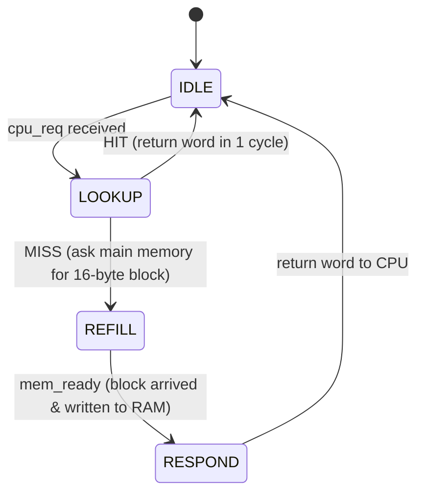

# Direct-Mapped Cache Controller (Verilog)

A parameterized direct-mapped cache with a controller FSM, a main-memory interface and a trace-driven testbench that reports hit/miss statistics and AMAT.

**Default configuration:** 1 KB cache, 16-byte blocks, 32-bit addresses → 64 lines
(tag = 22 bits, index = 6 bits, offset = 4 bits). You can change `CACHE_BYTES` and `BLOCK_BYTES` in `cache_top`.

## Structure

```
rtl/
  addr_decoder.v      tag / index / offset split
  tag_ram.v           tag storage
  valid_ram.v         valid bits (cleared on reset)
  data_ram.v          block storage, word select on read
  tag_comparator.v    hit = valid && tag match
  cache_controller.v  FSM: IDLE -> LOOKUP -> (hit) IDLE
                                         -> (miss) REFILL -> RESPOND -> IDLE
  mem_interface.v     block fetch from main memory
  cache_top.v         top level
tb/
  main_memory.v       memory model with 10-cycle latency
  tb_cache.v          replays a trace, checks data, prints stats + AMAT
traces/               sequential, random, repeated access traces
scripts/              gen_traces.py, run_sim.sh
synth/                Yosys script and report
results/              per-trace outputs and report.md
```

## Controller FSM

| State   | Action                                                         |
| ------- | -------------------------------------------------------------- |
| IDLE    | Wait for `cpu_req`, then latch the address                   |
| LOOKUP  | Read tag + valid. Hit: return data. Miss: start memory fetch   |
| REFILL  | Wait for the block, then write data, tag and set the valid bit |
| RESPOND | Return the requested word to the CPU                           |

## Requirements

- [Icarus Verilog](https://steveicarus.github.io/iverilog/) (`brew install icarus-verilog` / `sudo apt install iverilog`)
- Python 3 (trace generation)
- Yosys for synthesis (`brew install yosys`)
- GTKWave or Surfer for waveforms (optional)

## Run

```bash
./scripts/run_sim.sh          # generates traces, simulates all three, writes results/
yosys -s synth/synth.ys       # synthesis -> synth/synth_report.txt
gtkwave build/dump.vcd        # waveform of the last simulated trace
```

## Results

| Trace      | Hit ratio | Miss ratio | AMAT (cycles) |
| ---------- | --------: | ---------: | ------------: |
| Sequential |   75.00 % |    25.00 % |         4.250 |
| Random     |    0.78 % |    99.22 % |        13.898 |
| Repeated   |   96.88 % |     3.12 % |         1.406 |

Hit time = 1 cycle, miss penalty = 13 cycles. The full analysis is in [results/report.md](results/report.md).

## Scope

The cache is read-only: it handles lookup and refill, which is what the assignment asks for. Write policies (write-through or write-back) are not implemented.


#### Explaination:

This is the standard model for an **Instruction Cache (I-Cache)**:

* A CPU never writes into its own program instructions (`sw`into code is forbidden in modern architectures).
* The I-Cache only reads instructions from memory, refills its lines on misses, and accelerates instruction execution.

So the cache is constantly reading from Main Memory and **writing blocks into its internal SRAM**—it just doesn't need to support CPU stores (`sw`).

If you ever want to add `sw`to this design, all you need is a `cpu_wr`write enable signal and a write-through or write-back policy

Here is the 4-step roadmap:

---

### Step 1: The Core Concept (Address Splitting)

A cache is just a small, fast memory table. In this project, an incoming 32-bit CPU address is split into 3 parts:

```
 31                        10 9         4 3        0
┌────────────────────────────┬───────────┬──────────┐
│         Tag (22b)          │ Index (6b)│Offset(4b)│
└────────────────────────────┴───────────┴──────────┘
```

1. **Offset (4 bits):** Points to the exact byte/word within the 16-byte block.
2. **Index (6 bits):** Picks 1 of the 64 rows (lines) in the cache table.
3. **Tag (22 bits):** The ID card stored in that row to check if it's the address we actually want.

 **File to read first:** [rtl/addr_decoder.v](file:///Users/yashagarwal/Downloads/WORK/Projects_Main/direct-mapped-cache/rtl/addr_decoder.v) — it's doing this exact bit-slicing.

---

### Step 2: The Datapath (The Storage & Check)

When the index selects row `N`, the cache checks two questions:

1. **Is the row occupied?** → Checked by [rtl/valid_ram.v](file:///Users/yashagarwal/Downloads/WORK/Projects_Main/direct-mapped-cache/rtl/valid_ram.v) (1 bit per line).
2. **Does the tag match?** → Checked by [rtl/tag_ram.v](file:///Users/yashagarwal/Downloads/WORK/Projects_Main/direct-mapped-cache/rtl/tag_ram.v) and [rtl/tag_comparator.v](file:///Users/yashagarwal/Downloads/WORK/Projects_Main/direct-mapped-cache/rtl/tag_comparator.v).

If both are true: **HIT!**

* The cache pulls the data directly from [rtl/data_ram.v](file:///Users/yashagarwal/Downloads/WORK/Projects_Main/direct-mapped-cache/rtl/data_ram.v) in **1 clock cycle**.

---

### Step 3: The Brain (The Controller FSM)

This is the most important file in the project: [rtl/cache_controller.v](file:///Users/yashagarwal/Downloads/WORK/Projects_Main/direct-mapped-cache/rtl/cache_controller.v).

Open it and look at its 4 states:



* **On a Hit:** Fast path (`IDLE` $\rightarrow$ `LOOKUP` $\rightarrow$ `IDLE`) = **1 cycle**.
* **On a Miss:** Slow path (`IDLE` $\rightarrow$ `LOOKUP` $\rightarrow$ `REFILL` $\rightarrow$ `RESPOND` $\rightarrow$ `IDLE`) = **13 cycles** (10 cycles waiting for DRAM + 3 controller cycles).

Then check [rtl/cache_top.v](file:///Users/yashagarwal/Downloads/WORK/Projects_Main/direct-mapped-cache/rtl/cache_top.v) to see how it wires the datapath and controller together.

---

### Step 4: The Benchmark & Metrics

Once you understand how one request works, look at how 500+ requests behave in a real program:

Open [tb/tb_cache.v](file:///Users/yashagarwal/Downloads/WORK/Projects_Main/direct-mapped-cache/tb/tb_cache.v) and [results/report.md](file:///Users/yashagarwal/Downloads/WORK/Projects_Main/direct-mapped-cache/results/report.md):

1. **Sequential trace (Spatial Locality):**
   * Accesses: Address `0x00`, `0x04`, `0x08`, `0x0C`, `0x10`...
   * Word 0 misses $\rightarrow$ fetches 16 bytes into the block.
   * Words 1, 2, and 3 are already in that block $\rightarrow$ **hits!**
   * Result: **$75\%$ hit rate** ($\frac{3}{4}$).
2. **Repeated trace (Temporal Locality):**
   * Loops through a small array 8 times.
   * Misses on the 1st pass, hits 100% on passes 2–8 $\rightarrow$ **$96.9\%$ hit rate**.
3. **AMAT (Average Memory Access Time):**
   $$
   \text{AMAT} = \text{Hit Time} + (\text{Miss Rate} \times \text{Miss Penalty})
   $$

   Sequential: $1 + (0.25 \times 13) = \mathbf{4.25\text{ cycles}}$.

---

### Suggested First Action

Start by opening [rtl/cache_controller.v](file:///Users/yashagarwal/Downloads/WORK/Projects_Main/direct-mapped-cache/rtl/cache_controller.v) and follow the `case (state)` block. It is under 90 lines and gives you the whole picture of how the hardware makes decisions.


1. The Purpose of tb/main_memory.v:

It plays the role of the external RAM chip during simulation.

Why it exists: When you simulate Verilog on your laptop, there is no physical RAM chip or motherboard plugged into your code.
What it actually does: It acts as a "fake" DRAM chip. When the cache asks for data, main_memory.v starts a counter:
Wait 10 clock cycles ⟶ Return 16 bytes of data
Wait 10 clock cycles⟶Return 16 bytes of data
Where it lives: In tb/ (Testbench). It is not real hardware you synthesize; it's test equipment.


2. The Purpose of rtl/mem_interface.v:

It is the "courier" inside the cache that handles talking to that external RAM.

Why it exists: External memory is slow and speaks a complex protocol (handshakes, multi-cycle delays, whole-block transfers). If the main cache controller had to do this directly, its logic would be messy.
What problems it solves:
Address Alignment: If the CPU asks for word address 0x00000004 or 0x0000000C, external memory cannot give you just that word. mem_interface.v strips off the lower 4 bits to request the aligned 16-byte block starting at 0x00000000.
The Handshake: It holds the mem_req wire high until memory signals mem_ready.
Holding Register: When the 128-bit block finally arrives, mem_interface catches it into an internal register (block_out) and sends a clean done = 1 pulse to the cache controller so it can write it into cache RAM.
