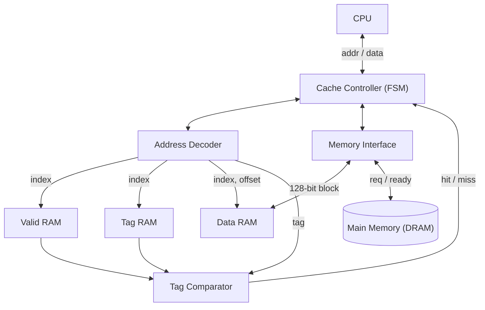
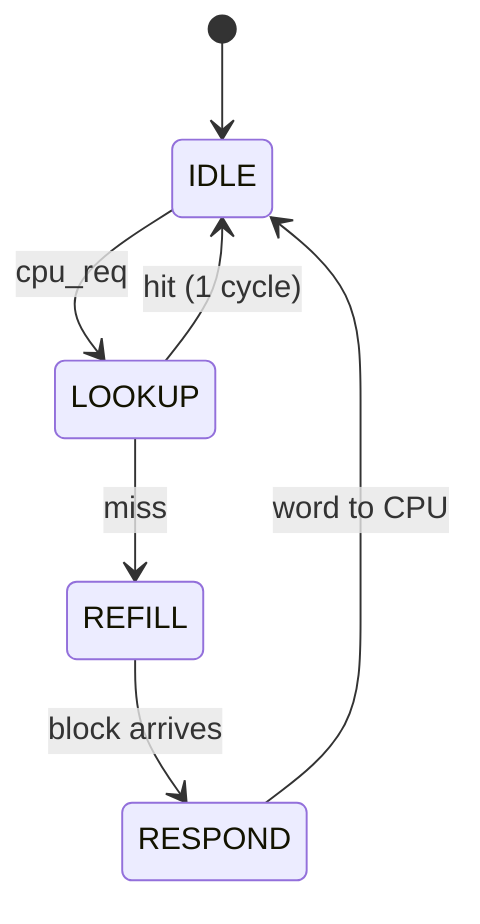
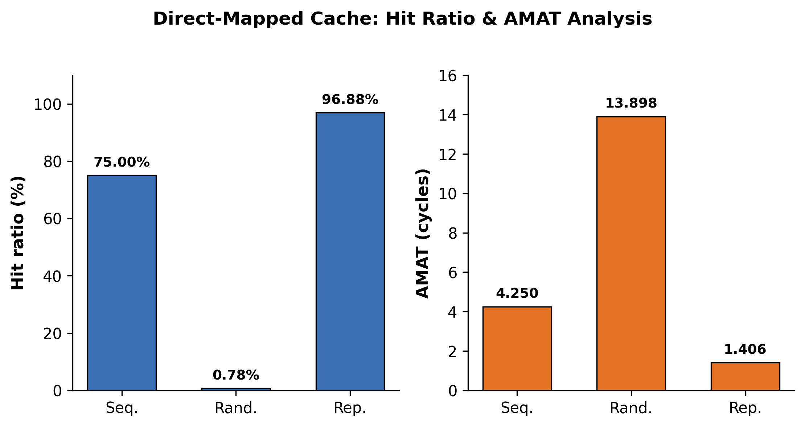

# Direct-Mapped Cache Controller (Verilog)

A parameterized direct-mapped cache with a 4-state controller FSM, a main-memory interface, and a trace-driven testbench that measures hit/miss statistics and Average Memory Access Time (AMAT).

> **Prototype Demo Video:** [Watch Demonstration Video](https://drive.google.com/file/d/1GKy-4Y65OcuxcwMOC8wwbGEnkBSRgpLZ/view?usp=sharing)
> **Phase I Report:** [IEEE_Project_Report_MCA.docx](IEEE_Project_Report_MCA.docx)

**Default Configuration:**

* **Capacity:** 1 KB cache
* **Block Size:** 16-byte blocks
* **Address Space:** 32-bit addresses $\rightarrow$ **64 lines** (Tag = 22 bits, Index = 6 bits, Offset = 4 bits)
* **Access Mode:** Read-only (models an Instruction Cache)
* Configurable via `CACHE_BYTES` and `BLOCK_BYTES` in `cache_top.v`.

---

## Architecture



### Address Breakdown

```
 31                        10 9         4 3        0
┌────────────────────────────┬───────────┬──────────┐
│         Tag (22b)          │ Index (6b)│Offset(4b)│
└────────────────────────────┴───────────┴──────────┘
```

* **Offset `[3:0]` (4 bits):** Points to the specific byte/word within the 16-byte block ($\log_2(16) = 4$).
* **Index `[9:4]` (6 bits):** Selects 1 of the 64 cache lines ($\log_2(64) = 6$).
* **Tag `[31:10]` (22 bits):** Memory block identifier stored in Tag RAM ($32 - 6 - 4 = 22$).

---

## Controller Finite State Machine (FSM)



| State             | Action                                                                                                                                               |
| :---------------- | :--------------------------------------------------------------------------------------------------------------------------------------------------- |
| **IDLE**    | Wait for `cpu_req`, then latch the address.                                                                                                        |
| **LOOKUP**  | Read tag + valid bit. **Hit:** return word in 1 cycle $\rightarrow$ `IDLE`. **Miss:** start memory fetch $\rightarrow$ `REFILL`. |
| **REFILL**  | Wait for 16-byte block from memory, write data & tag, and assert the valid bit $\rightarrow$ `RESPOND`.                                          |
| **RESPOND** | Pulse `cpu_ready = 1` and hand the requested 32-bit word to the CPU $\rightarrow$ `IDLE`.                                                      |

---

## Project Structure

```
rtl/
  addr_decoder.v      Tag / Index / Offset bit splitting
  tag_ram.v           Tag storage (64 × 22-bit)
  valid_ram.v         Valid bits with synchronous reset (64 × 1-bit)
  data_ram.v          Block storage (64 × 128-bit) with word multiplexing
  tag_comparator.v    Combinational hit detection (hit = valid && tag_match)
  cache_controller.v  4-state FSM controller (IDLE, LOOKUP, REFILL, RESPOND)
  mem_interface.v     Block-aligned memory fetch courier
  cache_top.v         Top-level integration
tb/
  main_memory.v       Behavioral DRAM model with 10-cycle latency
  tb_cache.v          Trace-driven testbench (data verification + AMAT)
traces/               sequential.hex, random.hex, repeated.hex
scripts/              gen_traces.py, run_sim.sh
synth/                synth.ys (Yosys script) and synth_report.txt
results/              Per-trace logs, report.md, and plots.png
```

---

## How to Run

### Requirements

* [Icarus Verilog](https://steveicarus.github.io/iverilog/) (`brew install icarus-verilog` / `sudo apt install iverilog`)
* Python 3
* [Yosys](https://yosyshq.net/yosys/) (optional, for synthesis: `brew install yosys`)

### Simulation & Verification

```bash
./scripts/run_sim.sh          # generates traces, compiles, simulates all three
yosys -s synth/synth.ys       # synthesis report -> synth/synth_report.txt
```

---

## Performance Results



| Trace                | Accesses | Hits | Misses |     Hit Ratio     | Miss Ratio |  AMAT (cycles)  |
| :------------------- | :------: | :--: | :----: | :---------------: | :--------: | :--------------: |
| **Sequential** |   512   | 384 |  128  | **75.00 %** |  25.00 %  | **4.250** |
| **Random**     |   512   |  4  |  508  | **0.78 %** |  99.22 %  | **13.898** |
| **Repeated**   |   1024   | 992 |   32   | **96.88 %** |   3.12 %   | **1.406** |

$$
\text{AMAT} = \text{Hit Time} + (\text{Miss Rate} \times \text{Miss Penalty})
$$

* **Hit Time:** 1 cycle
* **Miss Penalty:** 13 cycles (10 cycles DRAM latency + 3 controller overhead cycles)
* **Correctness:** All returned words verified against the memory model with **0 data errors**.

---

### Locality Analysis

* **Sequential (Spatial Locality):** Each 16-byte block holds four 32-bit words. Word 0 misses and triggers a refill; words 1, 2, and 3 hit in cache $\rightarrow$ exact $\frac{3}{4} = \mathbf{75\%}$ hit ratio.
* **Repeated (Temporal Locality):** Looping over a 512-byte array (32 cache lines). Pass 1 causes 32 compulsory misses; passes 2 through 8 achieve 100% hits $\rightarrow \mathbf{96.88\%}$ hit ratio.
* **Random (Worst Case):** Addresses scatter across 64 KB ($64\times$ cache size). Almost every access conflicts and evicts, yielding close to the theoretical $\frac{1}{64} = \mathbf{1.56\%}$ bound.

---

## Synthesis Results (Yosys)

Synthesized using generic technology library (`synth -top cache_top`):

* **Total Logic Cells:** 20,697 cells
* **Storage Flip-Flops:** 9,600 D-flip-flops (8,192 data bits + 1,408 tag bits)
* **Valid Bit Flops:** 64 flip-flops with synchronous clear
* **Multiplexers:** ~9,139 MUXes for read routing and block selection
* **Verification Check:** 0 warnings / 0 design errors reported
